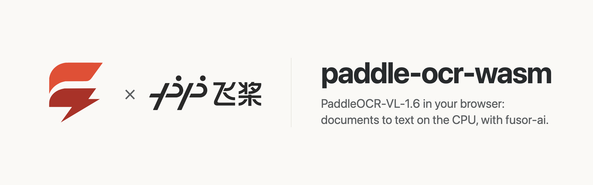

<p>
  <picture>
    <source media="(prefers-color-scheme: dark)" srcset="assets/brand/banner-dark.png">
    
  </picture>
</p>

# Documents to text in the browser, on the CPU

Drop, paste or pick an image and read its text, a table, a formula, a chart or a seal, read by PaddlePaddle's [PaddleOCR-VL-1.6](https://huggingface.co/PaddlePaddle/PaddleOCR-VL-1.6), a 0.9B vision-language model for documents, computed on your own device. No server, no API key, no GPU required, and once the model has loaded, no image leaves the page.

paddle-ocr-wasm is the app around the model: a [fusor](https://github.com/fusor-rs/fusor) page, the browser runtime and a native CLI. The model itself, compiled to WebAssembly, is built with [fusor-ai](https://github.com/fusor-rs/fusor-ai), the toolkit for AI runtimes in Rust and WebAssembly, from the published weights.

**In development · v0.1**: this is experimental software. See [status and known limitations](#status-and-known-limitations).

[Run it](#run-it-locally) · [How it works](#how-it-works) · [How fast is it](#how-fast-is-it) · [Benchmarks](benchmarks.md) · [Status](#status-and-known-limitations) · [Contributing](CONTRIBUTING.md)

## Run it locally

You need Rust 1.99 or newer, installed with [rustup](https://rustup.rs), Node.js 22 or newer and [`just`](https://github.com/casey/just). Then:

```sh
git clone --recurse-submodules https://github.com/fusor-rs/paddle-ocr-wasm && cd paddle-ocr-wasm
just ui
```

and open the address it prints. That's all: `just ui` installs the pinned tools (the threads toolchain with rustup; wasm-bindgen, binaryen and the fusor CLI into `.tools/`), downloads the checkpoint at a pinned revision (1.9 GB, each file sha256-checked), compiles it into an 831 MB bundle, builds the four browser runtimes (a few minutes the first time, seconds after) and the page, and serves it on `http://localhost:8787` with the bundle beside it.

Drop an image on the page, paste one, or choose a file; pick what to read it as (**Text**, **Table**, **Formula**, **Chart** or **Seal**) and press **Read**, even while the model is still loading: the image is read the moment the model is ready. The answer appears token by token; a table is drawn as a table, with its OTSL cells below it to copy. Every reading is measured live: the time to the answer's first token, the tokens written per second, the size the image was resized to and its tokens, and the network requests since the model loaded, which stay at zero.

## More ways to run it

### Build everything from source

```sh
just build    # also downloads the checkpoint (1.9 GB, sha256-checked) and compiles the bundle
just serve
```

`CHECKPOINT=<dir>` reuses a checkpoint you already have, `PROFILE=q7` compiles the 1 GB bundle with every large matrix in 7 bits, and `PROFILE=f32` the 3.6 GB full-precision one that `just parity` checks against the reference.

### The CLI

The CLI reads PNG and JPEG files without a browser:

```sh
target/release/paddle-ocr read dist/model page.png
target/release/paddle-ocr read dist/model invoice.jpg --task table
```

`paddle-ocr bench` measures each stage on an image and `paddle-ocr parity` compares every stage with the reference's outputs.

## How it works

- **The model runs in your tab.** The runtime is PaddleOCR-VL-1.6 compiled to WebAssembly with fusor-ai: the image is resized so both sides are whole 28-pixel blocks within the model's pixel budget and cut into 14×14 patches; a 27-layer NaViT vision encoder reads all of them at once, each patch turned by its row and column (2-D rotary embeddings) and given the learned position grid resampled to the image; a projector folds every 2×2 block of patches into one token; and ERNIE 4.5 0.3B reads the prompt with the image's tokens in it, each turned by its time, row and column (multimodal RoPE), and writes the answer greedily.
- **The reference's pixels, exactly.** The resize is Pillow's bicubic filter reimplemented to the bit, fixed-point rounding included, and the prompt's ids and its rotary positions are the reference's one for one; every stage but the vision encoder's attention agrees with PyTorch within 7·10⁻⁶.
- **Long attention, in int8.** A page is up to 5120 patches that all attend to each other. Each thread quantizes a head's keys and values once per layer (the keys' mean subtracted first, which the softmax ignores) and runs both products on the same int8 kernels as the weights. It moves the encoder's output by 1% and no answer on the test images, and reaches a page's first token about a third sooner than f32.
- **Quantized where it holds.** The vision layers are 4-bit and everything else 7-bit, 831 MB in all against the checkpoint's 1.9 GB. The language model keeps 7 bits: in 4 it falls into repeating itself. SigLIP's MLP of 4304 units is padded with zero units to whole quantization blocks, which changes nothing it computes.
- **One stage per step.** The engine worker reads in steps (the vision tower, the prompt, then one token of the answer at a time) and posts the answer after each, so the text streams and Stop takes effect between tokens.
- **Threads and SIMD where the browser has them.** The page picks one of four builds: worker threads when it is cross-origin isolated, relaxed SIMD when the engine supports it, plain SIMD128 everywhere else.
- **Downloaded once, verified always.** The bundle streams in parts, each checked against its BLAKE3 hash, and stays in the browser's origin-private storage, so the next visit loads from this device in about a second.
- **Sealed.** The runtime imports no network, storage, clock or entropy capability; fusor-ai's import check proves it on every build. The page counts its network requests while it reads, and the count is zero.
- **A fusor page.** The image, the task, the answer and the measurements are Rust signals with HTML templates; a small JavaScript module decodes the image and runs the engine worker.

## How fast is it

On an Apple M4 Pro in Chrome on eight threads, the page reads a formula to its first token in 0.9 s and a photographed book page, 3900 patches, in 9.3 s, then writes the answer at 270–370 tokens per second; on one thread, 6.4 s and 67 s. The four clean test images (a text line, a table, a formula, a seal) read exactly as the PyTorch reference reads them. [benchmarks.md](benchmarks.md) has the full measurements, in Chrome, in Node and natively against PyTorch, including the ones where we lose:

<picture>
  <source media="(prefers-color-scheme: dark)" srcset="assets/benchmarks/benchmarks-dark.png">
  
</picture>

Natively, PyTorch reaches the first token on large images 1.2–1.4× sooner: its f32 matrix products run on the M4's matrix units through Apple's Accelerate, while fusor-ai's int8 kernels are written for WebAssembly SIMD first. Once the answer starts, fusor-ai writes it 5–7× faster.

## Documentation

| Guide | Covers |
| --- | --- |
| [Benchmarks](benchmarks.md) | Time to the first token, tokens per second, agreement with the reference and download, and how to reproduce them |
| [Contributing](CONTRIBUTING.md) | Setup, checks, the reference, moving fusor-ai, deploying |
| [AGENTS.md](AGENTS.md) | The code standard every change follows |

## Status and known limitations

paddle-ocr-wasm is v0.1 and experimental.

### Platform status

| Platform or capability | Status |
| --- | --- |
| Chrome and Edge, threads and relaxed SIMD | Headless Chrome end-to-end check (`just e2e`): read while loading, a table, a formula, a book page, revisit |
| Browsers without relaxed SIMD (Safari, older Firefox) | SIMD128 builds, checked in Node (`just smoke`); not tested in those browsers |
| Pages without cross-origin isolation | Single-threaded builds: 6 s to a formula's first token, about 70 s for a full page on an Apple M4 Pro |
| Native CLI (macOS on Apple silicon) | Built and measured; no release archives yet |
| Phones | Not measured; the threaded builds' memory may grow to 4 GB |

**Not supported yet:**

- Spotting (text with its location), which the model card reads at a larger pixel budget with its own resize.
- Whole-page parsing: PaddleOCR's pipeline first cuts a page into regions with a layout model and reads each one; here the model reads the whole image you give it under one task, best for a region, a table, a formula or a page of plain text.
- Rendering formulas: the LaTeX is shown as text.
- A GPU backend.

The model is Apache-2.0: [PaddleOCR-VL-1.6](https://huggingface.co/PaddlePaddle/PaddleOCR-VL-1.6) by PaddlePaddle. The test images are PaddleOCR's own test files (Apache-2.0), downloaded at a pinned commit.

## How is this different from PaddleOCR?

[PaddleOCR](https://github.com/PaddlePaddle/PaddleOCR) is PaddlePaddle's own toolkit for the model: Python, PaddlePaddle or vLLM on a server or a GPU, with a layout model in front that cuts a page into regions. paddle-ocr-wasm is a separate implementation on fusor-ai: the same weights, its own kernels, preprocessing and decoding, with every stage checked against the PyTorch reference, running in the browser.

## How is this different from a cloud OCR API?

A cloud API sends your documents to a server and bills per page. paddle-ocr-wasm runs on your device after a one-time download: it works offline, costs nothing per page, and your images never leave the page.

## Contributing

paddle-ocr-wasm is an open source project in early development. The [contributing guide](CONTRIBUTING.md) covers the setup, checks and workflow. The runtime and the CLI live in `crates/` and the page in `app/`; the model and its toolkit come from fusor-ai, its crates from crates.io and its browser scripts from `vendor/fusor-ai`.

paddle-ocr-wasm is built with the help of AI tools, mainly Claude Code, under the same rules the project asks of contributors: see [Using AI tools](CONTRIBUTING.md#using-ai-tools).

## License

Licensed under the [MIT License](LICENSE).
